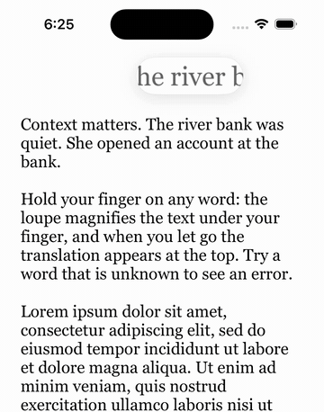

# LitraKit

Long-press a word in a `UITextView` — LitraKit shows a loupe under your finger,
underlines the word, asks **your** translator for a translation and shows the whole
translated sentence in a strip above the text, with the word centered and underlined.



- **Attaches to your text view.** Your fonts, insets and layout stay yours; LitraKit adds
  the gesture, the loupe, the underline and the translation strip on top.
- **Bring your own translator.** One async method. LitraKit never touches the network,
  API keys or a provider SDK.
- **Context-aware.** The translator receives the whole sentence, so “bank” can be
  “берег” next to a river and “банк” next to an account.
- **Zero dependencies.** UIKit core, SwiftUI wrapper included. iOS 15+.

## Installation

Swift Package Manager:

```swift
.package(url: "https://github.com/andreileganov/LitraKit.git", branch: "main")
```

## Usage

```swift
import LitraKit

final class MyTranslator: LitraTranslating {
    func translate(word: String, in sentence: String) async throws -> LitraTranslation {
        let result = try await myBackend.translate(word, context: sentence)
        return LitraTranslation(
            translation: result.word,                 // "взволновать"
            sentenceTranslation: result.sentence,     // "Его голос взволновал их."
            translatedWord: result.wordInSentence     // "взволновал" — centered and underlined
        )
    }
}

let textView = UITextView()
textView.isEditable = false
textView.text = chapter

let litra = LitraKitView(textView: textView)
litra.translator = MyTranslator()
litra.delegate = self
view.addSubview(litra)
```

Get the results (all methods are optional):

```swift
extension ReaderViewController: LitraKitDelegate {
    func litraKit(_ view: LitraKitView, didTranslate word: String, in sentence: String, translation: String) {
        saveFlashcard(word: word, sentence: sentence, translation: translation.translation)
    }
}
```

### SwiftUI

```swift
LitraKitView.Representable(text: chapter, translator: translator) { word, sentence, translation in
    saveFlashcard(word: word, sentence: sentence, translation: translation.translation)
}
```

### Configuration

```swift
var config = LitraKitConfiguration()
config.underlineColor = .systemOrange
config.loupeMagnification = 1.8
config.minimumPressDuration = 0.3
config.showsLoupe = true
let litra = LitraKitView(textView: textView, configuration: config)
```

## Public API

Five types, nothing else:

| Type | Role |
|---|---|
| `LitraKitView` | Wraps your `UITextView`; `LitraKitView.Representable` for SwiftUI |
| `LitraTranslating` | Your translator: `translate(word:in:) async throws -> LitraTranslation` |
| `LitraTranslation` | Word translation, plus optional sentence translation and the word's form inside it |
| `LitraKitDelegate` | `didSelect`, `didTranslate`, `didFailToTranslate` |
| `LitraKitConfiguration` | Underline color, loupe size and magnification, press duration |

## Design notes

- **Wraps, doesn't replace.** Readers already have their own typography and pagination,
  so LitraKit attaches to an existing `UITextView` instead of shipping its own text view.
- **Underline as a layer.** The underline is a `CAShapeLayer` inside the text view's
  content, not an attribute on your text — your attributed string is never modified, and
  the line scrolls with the text for free.
- **Loupe from one snapshot.** The text doesn't change during the gesture, so one image is
  taken when the press begins; moving the finger only shifts the layer's `contentsRect`.
  One snapshot instead of a re-render on every frame. Like the system loupe, it follows
  the finger horizontally and stays centered on the current line.
- **Sentence strip.** The translated sentence sits on one line with the translated word
  pinned to the horizontal center and the edges fading out — you read the word in context
  without a popup covering the text. Without a sentence translation it shows just the word.
- **Results through the delegate.** A lookup is async and can be superseded: picking a new
  word cancels the previous `Task`, and a late result for an old word is dropped even if
  the translator ignores cancellation.
- **Translator as a protocol.** No keys, networking or provider lock-in inside the library.

## Example app

`Examples/LitraKitDemo` — UIKit and SwiftUI tabs with a mock translator.

```bash
open Examples/LitraKitDemo/LitraKitDemo.xcodeproj
```

The project is generated from `Examples/LitraKitDemo/project.yml` with
[XcodeGen](https://github.com/yonaskolb/XcodeGen).

## Tests

```bash
xcodebuild test -scheme LitraKit -destination 'platform=iOS Simulator,name=iPhone 16'
```

Covers word and sentence lookup (punctuation, apostrophes, Cyrillic, emoji, paragraph
bounds) and request cancellation.

## License

MIT
